


 

<!-- TODO: after enabling GitHub Pages, check the website URL above matches Settings > Pages -->

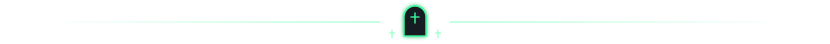

<h2 align="center">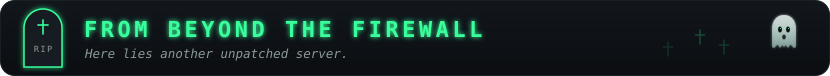</h2>

I'm **GPHL125241O**, a penetration tester and red teamer. I work in the gap between "it works" and "it's secure": enumerating, breaking (with permission), and then explaining exactly how to fix what I broke.

I run [**Ghost Protocol Labs**](https://github.com/Ghost-Protocol-Lab), our offensive security lab, where we publish practical write-ups, organize events and share daily challenges for people learning to hack.

<!-- TODO: add a line about what you're working on or learning right now -->

<!-- TODO: edit these skills to match what you actually do -->

| | Domain | Focus |
|---|---|---|
| 🌐 | **Web application pentesting** | OWASP Top 10 · auth and session attacks · injection · API security · business logic flaws |
| 🛰️ | **Network and infrastructure** | recon and enumeration · service exploitation · pivoting and tunneling · traffic analysis |
| 🏰 | **Active Directory attacks** | AD enumeration · Kerberos attacks · credential abuse · lateral movement |
| 🐧 | **Privilege escalation** | Linux · Windows · misconfiguration hunting |
| 🕶️ | **Red team operations** | initial access tradecraft · post-exploitation · C2 · evasion concepts · adversary emulation |
| 🕵️ | **OSINT** | passive recon · infrastructure mapping · exposure and leak discovery |
| 📝 | **Reporting** | clear technical write-ups · risk rating · remediation guidance |

<h2 align="center">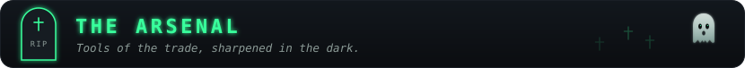</h2>

<!-- TODO: edit the badges below to match your real tech stack -->

**Offensive tools** 

**Languages** 

**OS and platforms** 

<h2 align="center">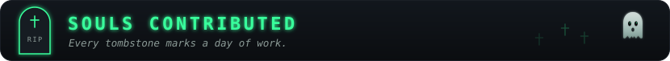</h2>

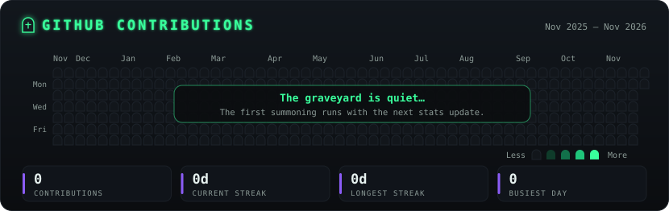

<h2 align="center">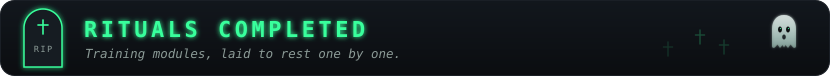</h2>


<h2 align="center">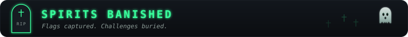</h2>


Charts regenerate every night at 00:05 IST from [`data/modules.json`](data/modules.json) and [`data/ctfs.json`](data/ctfs.json).

<h2 align="center">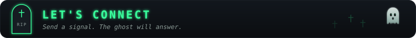</h2>

<!-- TODO: replace every TODO_* link below with your real URL, or delete the badge you don't want -->

 


All content is for education and authorized security testing only.

